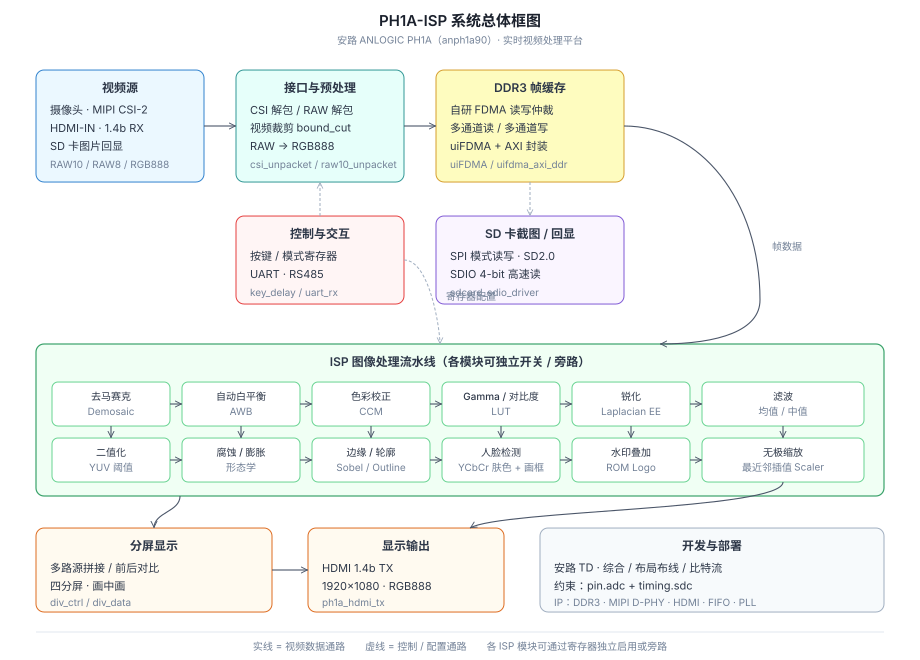
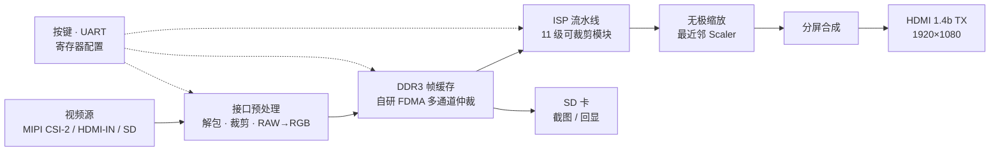

<div align="center">

# PH1A-ISP

**基于安路 ANLOGIC PH1A（anph1a90）的实时视频处理平台**

<br/>


<br/>

**采集 → 缓存 → 处理 → 显示**

一套跑在 FPGA 上的完整实时视频处理链路。
自研 FDMA 多通道 DDR 仲裁 + 可裁剪 ISP 流水线 + 无极缩放 / 分屏 / 截屏。

<br/>



<br/>

[Features](#-核心能力) ·
[Architecture](#-系统架构) ·
[Performance](#-性能指标) ·
[Getting Started](#-快速上手) ·
[Structure](#-工程结构)

</div>

---

## 目录

- [项目简介](#-项目简介)
- [核心能力](#-核心能力)
- [系统架构](#-系统架构)
- [性能指标](#-性能指标)
- [硬件平台](#-硬件平台)
- [快速上手](#-快速上手)
- [工程结构](#-工程结构)
- [开源说明](#-开源说明)
- [获奖](#-获奖)
- [License](#-license)

---

## 项目简介

PH1A-ISP 是一套运行在安路 PH1A FPGA 上的**实时视频处理系统**。平台以摄像头 / HDMI-IN / SD 卡为多路数据源，通过自研 DDR 多通道读写仲裁完成帧缓存，再经可裁剪的 ISP 流水线输出至 HDMI 显示器。

整条链路支持 **1920×1080 实时处理**，并提供无极缩放、分屏对比、一键截屏、人脸检测与水印叠加等特性，可广泛应用于**安防监控、工业检测、互动娱乐**等场景。

---

## 核心能力

### 1 · ISP 图像处理流水线

> 11 级处理模块全部可通过寄存器独立开关 / 旁路，按键实时切换观察效果。

| 模块 | 算法要点 | 输出效果 |
| --- | --- | --- |
| **去马赛克** `Demosaic` | RGGB Bayer 插值 + 色差恒定约束 | RAW → 全彩 RGB888 |
| **自动白平衡** `AWB` | 灰度世界假设，逐帧统计通道均值 | 消除色偏，还原真实色彩 |
| **色彩校正** `CCM` | 24 色卡采集 + 最小二乘求解 3×3 矩阵 | 色彩逼近人眼感知 |
| **Gamma / 对比度** | LUT 非线性映射，7 挡可调 | 亮度层次分明 |
| **锐化** `EE` | 拉普拉斯二阶微分算子 | 边缘细节增强 |
| **滤波** | 均值 / 中值双模式 | 降噪同时保留边缘 |
| **二值化** | YUV 色域帧均值全局阈值 | 前景 / 背景分离 |
| **腐蚀 / 膨胀** | 3×3 形态学结构元 | 去噪、连通区域修补 |
| **边缘 / 轮廓** | Sobel 梯度 + 形态学梯度 | 轮廓层次清晰 |
| **人脸检测** | YCbCr 肤色阈值 + 行列扫描画框 | 强光 / 复杂背景稳定框选 |
| **水印** | ROM 初始化图案，支持半透明 | 可见标识 / 信息提示 |

### 2 · 无极缩放

基于最近邻插值的实时 Scaler。由输入 / 输出分辨率计算缩放系数，将输出像素坐标映射回原图取样，支持**任意比例平滑缩放**，兼顾图像质量与资源占用。

### 3 · 自研 FDMA 多通道 DDR 仲裁

传统 AXI4 仲裁 LUT/BRAM 消耗大、通道数上升后时序难收敛。本项目自研基于 FDMA 的多通道读写仲裁器：

- **阻塞式优先级调度**——某通道占用总线时，其余通道有序等待
- **资源可控**——相对传统方案显著降低 LUT / BRAM 占用
- **通道数可扩展**——时序稳定，支持更多并发读写

### 4 · 分屏显示

多路视频源拼接显示与处理前后同屏对比。各路先经无极缩放适配子窗口尺寸，再由 DDR 仲裁统一读出合成。

### 5 · SD 卡截图与回显

| 能力 | 说明 |
| --- | --- |
| 截图存档 | 按键触发，当前帧（RAW8）写入 SD 卡，写入期间暂停输入保证一致性 |
| 图片回显 | 从 SD 卡读出图像逐行送入 DDR 显示 |
| 高速读 | SDIO 4-bit 模式已验证，速率约为 SPI 的 **4 倍** |

---

## 系统架构

### 数据通路



### 时钟域与数据格式

| 阶段 | 时钟域 | 像素格式 | 分辨率 |
| --- | --- | --- | --- |
| 传感器采集 | CSI PCLK | RAW10 / RAW8 | 1920×1080 |
| 解包 / 裁剪 | 系统时钟 | RGB888 | 1920×1080 |
| DDR 缓存 | DDR UI 时钟 | RGB888 | 帧缓存 |
| ISP 处理 | 像素时钟 | RGB888 / YUV | 1920×1080 |
| HDMI 输出 | TX 时钟 | RGB888 | 1920×1080 |

---

## 性能指标

<div align="center">

| 指标 | 数值 |
| :---: | :---: |
| 视频规格 | **1920 × 1080 实时** |
| DDR 利用率 | **≈ 90 %** |
| 缩放倍率 | **任意比例**（最近邻插值） |
| ISP 级数 | **11 级**独立可裁剪 |
| 人脸检测 | 强光 / 复杂背景下稳定框选 |
| SD 截屏（SPI） | **≈ 4 s / 帧**（SDIO 可显著缩短） |

</div>

---

## 硬件平台

| 项目 | 规格 |
| --- | --- |
| FPGA | 安路 **ANLOGIC PH1A**（anph1a90 开发板） |
| 存储 | DDR3 帧缓存 |
| 视频输入 | MIPI CSI-2 摄像头 / HDMI-IN 1.4b |
| 视频输出 | HDMI 1.4b TX，1920×1080 |
| 存储卡 | 32GB SDHC（SD2.0，SPI / SDIO） |
| 其它 | 按键、UART / RS485、LED |
| 开发环境 | 安路 **TD（Tang Dynasty）** |

---

## 快速上手

> 顶层模块：`rtl/hdl_source/design_top_wrapper.v`

**Step 1 · 环境准备**

安装安路 **TD（Tang Dynasty）** 开发环境。

**Step 2 · 创建工程**

新建 PH1A（anph1a90）工程，加入源码与约束：

```text
rtl/                       →  添加为源文件目录
constraints/pin.adc        →  管脚约束
constraints/timing.sdc     →  时序约束
```

**Step 3 · IP 重建（可选）**

如需重新生成 IP，使用 TD 的 **IP Catalog** 按 `rtl/ip_source/` 中现有配置创建同名 IP。

**Step 4 · 综合与下载**

```text
综合  →  布局布线  →  生成比特流  →  下载到开发板
```

**Step 5 · 运行**

上电后通过**按键**切换 ISP 处理模式，HDMI 显示器实时查看效果。

<details>
<summary><b>ISP 模式切换说明</b></summary>

<br/>

各 ISP 模块通过寄存器独立控制，按键扫描切换 HDMI 输出通路，可在原始图像与各级处理结果之间实时对比。

</details>

---

## 工程结构

<details>
<summary><b>展开完整目录树</b></summary>

<br/>

```text
PH1A-ISP/
├── README.md
├── LICENSE
├── docs/
│   └── system_block_diagram.svg     系统总体框图
├── constraints/
│   ├── pin.adc                      管脚约束
│   └── timing.sdc                   时序约束
└── rtl/
    ├── hdl_source/                  顶层、ISP 核心、FDMA、水印
    ├── ip_source/                   IP：DDR3、MIPI D-PHY、HDMI、FIFO、PLL
    ├── average_filter/              均值滤波
    ├── mid_filter/                  中值滤波
    ├── binary/                      二值化
    ├── ersion/ dilation/            腐蚀 / 膨胀
    ├── sobel_new/ outline/          边缘 / 轮廓
    ├── ee/                          锐化
    ├── gamma/ gamma_contrast/       Gamma 与对比度
    ├── haze_remove/                 暗通道去雾（扩展模块）
    ├── face_detect/                 人脸检测
    ├── watermark/                   水印
    ├── scare/                       无极缩放
    ├── dvi/                         分屏
    ├── diff_fram/                   帧差 / 选框
    ├── sdio/                        SD 卡驱动
    ├── uart/ key/ ctrl/             通信与控制
    ├── yuv/                         色彩空间转换
    └── mif/                         ROM 初始化数据
```

</details>

---

## 开源说明

本仓库仅开源**视频处理平台**部分（ISP 流水线、存储与显示控制）。竞赛作品中涉及的深度学习加速模块未包含在本仓库中，顶层对应接口已做静态绑定以便完整综合。

---

## 获奖

<div align="center">

### 2024 年全国大学生嵌入式芯片与系统设计竞赛

**FPGA 赛道（安路） · 全国一等奖**

</div>

---

## License

本项目采用 [MIT License](LICENSE) 开源。

<div align="center">
<br/>
<b>PH1A-ISP</b> · Real-time Video Processing on Anlogic PH1A
<br/>
</div>
